# Investigate, Fix or Escalate: Project Documentation for Partner Teams

*Status: November 2026. Pilot stage. This document describes the code in this repository as it stands. Questions that only the partner organisation can answer are marked **[PARTNER]** and listed at the end.*

**How to read this document.** Sections 1, 2.1, 6 and 7 are written for every reader. Sections 2.2 to 5 are for the engineers who will connect to the system.

---

## 1. Summary: the problem and what this project does

When an IT problem is reported, its cause is often unclear. The first evidence, a user's ticket or a few lines of an application log, can be incomplete, misleading, or consistent with several causes. Support staff then have three choices:

1. **Investigate**: gather more evidence (run a diagnostic check);
2. **Fix**: apply the remedy for the most likely cause;
3. **Escalate**: hand the incident to a person who is better placed to resolve it.

This project builds and evaluates a **decision assistant** that learns when to make each choice. It has three parts:

- A **reinforcement learning agent**: a program that learns by trial and error, in a simulator, which choice leads to the best results over many incidents.
- An independent **rule checker** (the "safety mechanism"). It holds the team's operating rules and blocks any fix those rules forbid, whatever the agent proposes.
- A **prototype** that runs the trained agent on a real-looking ticket and log, explains each step, and carries the decision out only in a safe, reviewable form: a *draft* code change on a fictional practice repository, a written fix request to the owner, or a written handover to a person.

The agent is trained and evaluated **only in simulation**. It is not connected to any production system. The simulator is built from a *scenario model*: IT staff describe incident causes, checks, symptoms and rules in a workbook. No tickets, logs or personal data are used for training.

**Who has the final say.**

- The **agent** chooses the next step.
- The **rule checker** can veto any fix the rules forbid. It checks every proposal during the incident, and checks the final decision a second time before anything is carried out.
- **A person** has the final say over anything that changes a system. Code changes are opened only as draft pull requests, which a person reviews and merges. Other fixes are sent to the owner as a request, and the owner carries them out. Nothing merges or deploys automatically.
- The **language model** (optional) never decides. It only fills in a fixed evidence form and must quote its source.

---

## 2. Architecture

### 2.1 Plain-language overview

1. A ticket and its log come in.
2. A **reader** picks out the facts: which symptoms are present, the context (production or not, priority), and what the log shows for each diagnostic check. Every fact keeps the sentence or log line it came from.
3. The **agent** looks at those facts and chooses one step: run a check, apply a fix, or escalate.
4. The **rule checker** blocks a forbidden fix. The agent then gets one more try. If its next proposal is also blocked, the incident goes to a person.
5. A chosen fix is **verified**: code fixes are tested on a throwaway copy of the code, and other fixes are confirmed by a person. If a fix fails, the agent sees that and continues. After two failed fixes, a person takes over.
6. The decision is **carried out and recorded**: a draft pull request, a fix request to the owner, or an escalation report. Each goes to an outbox folder as a written message. Messages are simulated and are not sent anywhere.

### 2.2 Architecture diagram

```mermaid
flowchart LR
    subgraph IN[Inputs]
        T[Ticket text]
        L[Log text]
    end

    subgraph READ[Reader - records evidence, never decides]
        KR[KeywordReader<br/>offline, default]
        HR[HybridReader / LocalReader<br/>local LLM via Ollama]
        CR[ClaudeReader<br/>external API, redacts first]
    end

    T --> READ
    L --> READ
    READ --> R[Reading<br/>symptoms, context, checks<br/>each with a verbatim quote]

    subgraph DECIDE[Decision loop - src/prototype/triage.py]
        A[Trained agent<br/>masked Double DQN]
        S{Rule checker<br/>SafetyMechanism}
        LK[Check lookup<br/>from logs, operator, or delegate]
        V[Verifier<br/>staging tests / operator]
    end

    R --> A
    A -- proposes action --> S
    S -- blocked once: masked, retry --> A
    S -- blocked twice --> ESC[Forced escalation]
    S -- permitted check --> LK --> A
    S -- permitted fix --> V
    V -- fix failed --> A
    V -- cleared / awaiting --> D[Decision report JSON]
    S -- escalate --> D
    ESC --> D

    D --> RC{Rule checker<br/>re-confirms final fix}
    RC -- permitted --> ACT[actions.act]
    D -- escalation --> ACT

    subgraph OUT[Outputs - human in control]
        PR[Draft pull request<br/>toy repo only, never merged]
        FO[Fix order to owner]
        ER[Escalation report<br/>routed to owner or fallback]
        OB[(Outbox folder<br/>results/pilot/outbox)]
    end

    ACT --> PR
    ACT --> FO
    ACT --> ER
    PR --> OB
    FO --> OB
    ER --> OB
```



### 2.3 Components and responsibilities

| Component | Code | Responsibility | Decides? |
|---|---|---|---|
| Scenario model | `experiments/pilot/pilot_model_v2.json`, built by `src/sim/load_model.py` from an elicitation workbook | Causes, remedies, checks, symptoms, context attributes, rules, costs, likelihood ratings | No |
| Settings | `experiments/pilot/pilot_settings_v3.json` | Rewards, check costs, noise, step limit, fix-with-verification settings | No |
| Simulator | `src/sim/scenario.py`, `src/sim/triage_env.py` (Gymnasium) | One incident per episode with a hidden cause; used for training and evaluation | No |
| Reader | `src/prototype/reading.py` (keyword), `llm.py` (Claude), `local_llm.py` (Ollama or an OpenAI-compatible endpoint) | Turns ticket and log text into a `Reading`; every finding carries a quote; LLM findings whose quote is not in the text are discarded | No |
| Agent | `src/agents/dqn.py` (`MaskedDQN`); trained run in `results/pilot/runs/v3_shielded_seed0/final.zip` | Chooses check, fix or escalate from the evidence | **Yes**: proposes each step |
| Rule checker | `src/rules/safety.py` (`RuleChecker`, `SafetyMechanism`) | Blocks a forbidden fix; first block returns the proposal once, second block in a row forces escalation; re-checks the final decision | **Veto** over fixes |
| Delegate | `src/prototype/delegate.py` | Answers the "delegated" check D11 (full log analysis) with a fixed prompt; offline pattern version by default | No |
| Verifier | `src/prototype/verify.py` | Says whether a fix cleared the symptoms: staging tests for code faults, otherwise the operator | No |
| Actions | `src/prototype/actions.py` | Carries a permitted decision out: draft PR, fix order or escalation report; routes to the owner; only allow-listed git and gh commands | No: refuses to act unless `permitted` is true |
| Interfaces | `src/prototype/cli.py`, `dashboard/prototype_app.py`, `dashboard/live_app.py`, `dashboard/app.py` (Streamlit) | Command line and dashboards | No |
| Evaluation | `src/evaluation.py`, `experiments/pilot/*` | Runs policies on fixed incidents and computes the measures | No |

### 2.4 Data flow, step by step (as coded in `triage()`)

1. `make_reader(name, model, config).read(ticket, logs)` returns a `Reading`. Context the ticket does not state takes the configured default. In the pilot, the default is the *stricter* case: production = Yes, priority = High, so the rules are switched on.
2. `LiveTriageEnv` is the training environment, with the random incident replaced by the `Reading`. It is wrapped in `SafetyMechanism`.
3. In a loop, the agent computes action values over the allowed actions (`action_masks`) and takes the best one (greedy):
   - **Check**: the result comes from the reading. A check the logs do not show is asked of the operator (`ask`), or answered by the delegate if it is the delegated check. Otherwise it is unavailable.
   - **Fix** (with verification settings): the verifier answers. A failed fix is flagged and cannot be chosen again. After `max_failed_fixes` (2) failed fixes, a person takes over.
   - **Escalate**: the incident ends.
   - A **blocked** proposal is recorded with the rule, the check that would lift it, and the reason.
4. The final fix is re-checked against the rules (`permitted`).
5. `act()` (only with `--act`) routes the incident and writes the message to the outbox. A fix whose `permitted` is not `true` raises `ActionRefused`.

**Routing.** A fix goes to the owner of its cause. An escalation goes to the owner of the most probable cause if that cause's probability is at least `route_threshold` (0.5). Otherwise it goes to `fallback_owner` (pilot: "Senior developer").

---

## 3. Data requirements and formats

### 3.1 What the system needs

| Input | Needed for | Format |
|---|---|---|
| Scenario model | Training, evaluation, prototype | JSON (below), normally built from the elicitation workbook |
| Settings | Training, evaluation, prototype | JSON (`pilot_settings_v3.json`) |
| Reader configuration | Prototype | JSON (`prototype_config.json`): keyword lists, log patterns and thresholds for each symptom, context value and check |
| Trained agent | Prototype | Stable-Baselines3-style `final.zip` and `config.json` in a run folder. **Not in git** (`*.zip` is ignored). A partner must retrain it or receive the file separately |
| Ticket | Prototype | Plain UTF-8 text |
| Logs | Prototype (optional) | Plain UTF-8 text, one event per line; lines may start with an ISO timestamp |

**No personal data is required.** The scenario model holds descriptions and ratings, not records. The workbook loader never reads who filled it in; provenance is passed as a role (`--rater`), never a name.

### 3.2 Scenario model schema (from `src/sim/load_model.py` and `pilot_model_v2.json`)

```jsonc
{
  "label": "pilot v2",
  "rater": "Software developer, 3 years' experience (one rater, not Directorate data)",
  "scale": {"Never": 0.05, "Rarely": 0.25, "Sometimes": 0.5, "Often": 0.75, "Almost always": 0.95, "Unrelated": 0.05},
  "default_probability": 0.05,
  "causes": [{
    "id": "C01", "category": "Infrastructure and external services",
    "name": "...", "description": "...", "remedy": "Set a timeout on the outbound call",
    "frequency": "Occasional",          // Rare | Occasional | Common (weights in settings)
    "code_fault": true,                 // v2: fixed by a code change, so a draft PR is possible
    "owner": "Integrations developer"   // v2: who receives the incident
  }],
  "checks": [{
    "id": "D01", "name": "Long outbound span in traces", "tests": "...",
    "positive_means": "Outbound call over 10s",
    "effort": "Low"                     // Low | Medium | High (minutes in settings)
    // "delegated": true                // optional: answered by the delegate (D11)
  }],
  "symptoms": [{"id": "S01", "name": "Users see a server error on a page", "reported_as": "..."}],
  "context":  [{"id": "X01", "name": "Affected system is production", "values": ["Yes", "No"]}],
  "rules": [{
    "id": "R01",
    "cause": "C02",                                  // the fix (remedy of this cause) that is forbidden
    "when": {"attribute": "X01", "value": "Yes"},     // only when this context holds
    "unless_observed": "D05",                         // lifted once this check has a result (or null)
    "reason": "Killing the wrong transaction rolls back valid work"
  }],
  "costs": {"escalation_minutes": 120.0, "wrong_fix_multiple": 5.0},
  "check_likelihoods":   [[/* per check: P(check positive | cause) for each cause */]],
  "symptom_likelihoods": [[/* per symptom: P(symptom present | cause) for each cause */]],
  "fallback_owner": "Senior developer"
}
```

Pilot model v2 sizes: 8 causes, 11 checks (one delegated), 4 symptoms, 2 context attributes, 5 rules. The planned full model has about 15 causes, 20 checks and 10 rules. The full elicitation with the partner has not been held yet; its date is still to be set **[PARTNER]**.

### 3.3 Input example (fictional, from `prototype/examples/sign_in/`)

`ticket.txt`
```text
Subject: Students cannot log in to the portal

Since about 7am students report that they cannot log in to the student portal, and some who do get in are logged out again after a few seconds. This is the production portal. The helpdesk has had many calls.
```

`logs.txt` (first lines)
```text
2026-10-28T16:00:00Z INFO  deploy release v3.8.0 deployed to production
2026-11-03T07:40:00Z INFO  db     active_transactions=6 oldest_tx_age=3s
2026-11-03T07:40:00Z INFO  node   api-1 cpu=38%
2026-11-03T07:40:00Z INFO  pool   db_pool in_use=9/20 (45%)
```

The keyword reader's log patterns are written for this example format, not for any real log format. A partner's logs need their own patterns in `prototype_config.json`. The partner's log format is not yet known **[PARTNER]**.

### 3.4 Output: the decision report

`triage()` returns a dictionary, and `--json` saves it. The response below is real output from `python -m src.prototype.cli --ticket prototype/examples/sign_in/ticket.txt --logs prototype/examples/sign_in/logs.txt --json report.json`, shortened where marked:

```jsonc
{
  "reading": {
    "reader": "keyword",
    "category": "Authentication and access",
    "summary": "Subject: Students cannot log in to the portal",
    "symptoms": {
      "S01": {"value": "present", "evidence": "2026-11-03T07:41:02Z ERROR api    POST /auth/login 500 duration=4.2s", "source": "logs"},
      "S03": {"value": "present", "evidence": "Subject: Students cannot log in to the portal", "source": "ticket"}
      // ... S02, S04: "not_mentioned"
    },
    "context": {
      "X01": {"value": "Yes", "evidence": "This is the production portal.", "source": "ticket"},
      "X02": {"value": "High", "evidence": "When the ticket does not say, assume the stricter case: ...", "source": "default"}
    },
    "checks": {
      "D01": {"value": "not_shown", "evidence": "", "source": "logs"},
      "D02": {"value": "positive", "evidence": "2026-11-03T07:41:02Z WARN  db     could not obtain lock on row in relation \"users\" (token update)", "source": "logs"}
      // ... one entry per check
    },
    "warnings": []
  },
  "steps": [{
    "action": "Fix C08: Move the token write off the sign-in path",
    "value": 3.104, "margin": 0.286, "escalate_value": -1.989,
    "alternatives": [{"action": "Fix C08: ...", "value": 3.104}, {"action": "Run D01 Long outbound span in traces", "value": 2.818}],
    "belief": [0.014, 0.028, 0.001, 0.005, 0.002, 0.09, 0.054, 0.807],
    "verification": {"cleared": true, "how": "staging tests",
                     "detail": "the incident's reproduction test (test_c08_sign_in_writes_the_user_row_once) now pass; 1 of 5 tests passing, 0 broken"}
  }],
  "decision": {
    "outcome": "fix",                   // fix | awaiting_verification | escalated | forced_escalation | step_limit | fix_limit
    "checks_run": 0, "check_minutes": 0, "blocked_proposals": 0,
    "attempts": [{"cause": "C08", "remedy": "Move the token write off the sign-in path", "cleared": true, "how": "staging tests"}],
    "cause": "C08", "cause_name": "Sign-in writes collide on the user row",
    "remedy": "Move the token write off the sign-in path",
    "permitted": true,                  // rule checker re-confirmed the final fix
    "verified": true
  },
  "warnings": [],
  "start_belief": [0.014, 0.028, 0.001, 0.005, 0.002, 0.09, 0.054, 0.807],
  "reference": [
    {"cause": "C08", "name": "Sign-in writes collide on the user row", "probability": 0.807},
    {"cause": "C06", "name": "Bad release or migration breaks a code path", "probability": 0.090}
  ]
}
```

Field notes:

- `belief` and `reference` are calculated from the ratings, for the person reading the report. **The agent never sees them.**
- A blocked step carries `"blocked_by": [{"rule": "R01", "needs": "D05", "reason": "..."}]`.
- A step that ran a check carries `result` (`positive`, `negative` or `unavailable`), `evidence` and `source`. A delegated check also carries `delegation`.
- For an escalation, `decision.reason` explains why: the agent's choice, two blocked proposals, the step limit, or two failed fixes.
- With `--act`, the report gains `action`: `{"kind": "draft_pull_request" | "fix_order" | "escalation", "owner", "routed_because", "message": <outbox file path>, "pull_request"?: {...}, "refused"?: "..."}`.

---

## 4. Integration guide

### 4.1 Interfaces available today

There is **no network API** (no HTTP or REST service) in the repository. A partner can connect in three ways:

1. **Python function interface** (recommended for integration):

```python
from pathlib import Path
from src.prototype.cli import load_inputs, make_reader, ROOT
from src.prototype.triage import load_agent, run_settings, triage
from src.prototype.delegate import make_delegate
from src.prototype.verify import make_verifier

run_dir = ROOT / "results/pilot/runs/v3_shielded_seed0"
model, config, scenario = load_inputs(settings_path=run_settings(run_dir, None))
agent = load_agent(run_dir)

ticket = Path("ticket.txt").read_text(encoding="utf-8")
logs = Path("logs.txt").read_text(encoding="utf-8")

reading = make_reader("keyword", model, config).read(ticket, logs)
verify = make_verifier(config["actions"], answers={})      # needed with v3 settings; see note
report = triage(reading, scenario, model, agent,
                ask=None,                                   # or a callback(check) -> Finding | None
                delegate=make_delegate("pattern", config),
                ticket=ticket, logs=logs, verify=verify)

# Optional: carry it out (draft PR on the toy repo / outbox message)
# from src.prototype.actions import act
# report["action"] = act(report, model, config["actions"], "INC-001", ticket, pr="local")
```

   Note: `make_verifier` takes the operator's confirmations as `answers`, a dict that maps a cause id to `True` (symptoms cleared) or `False` (they persist), e.g. `{"C02": True}`, or as an `ask(cause)` callback. A cause with no answer stops the incident as `awaiting_verification` (this snippet, run on `prototype/examples/results_approval`, ends that way after two blocked proposals and three checks). Code faults are verified by staging tests when `make_verifier` is given the case folder with a `verification.json`.

2. **Command line** (one incident per call, prints a readable report, optional JSON):

```bat
.venv\Scripts\python -m src.prototype.cli --ticket ticket.txt --logs logs.txt --json report.json
:: options: --reader keyword|local|local-full|claude   --ask   --delegate pattern|local|claude|off
::          --act --pr local|github|off --patcher pre-written|claude   --run <run folder>   --demo-verify
```

3. **Dashboards** (Streamlit), for people rather than systems:

```bat
.venv\Scripts\python -m streamlit run dashboard/prototype_app.py      :: full prototype, port 8501
run_live_demo.bat                                                     :: live incidents, port 8502
.venv\Scripts\python -m streamlit run dashboard/app.py                :: training monitor
```

A network service is not needed for now. If one is needed later, a thin wrapper around `triage()` is a small step.

### 4.2 Dependencies

- Python 3.13 (`requirements.txt`): gymnasium 1.4.0, stable-baselines3 2.9.2, sb3-contrib 2.9.2, torch 2.14.1, numpy, scipy, matplotlib, openpyxl, pytest, anthropic 2.4.0, requests, streamlit, altair, pandas.
- Optional: Ollama with `qwen3:4b` for the free local reader; `git` and the GitHub CLI `gh` for `--pr github`; an Anthropic API key for `--reader claude`.
- Windows is the only supported and tested platform (the scripts are batch files).

### 4.3 How to run it

```bat
python -m venv --system-site-packages .venv
.venv\Scripts\python -m pip install -r requirements.txt
.venv\Scripts\python -m pytest                                     :: about 5 minutes
.venv\Scripts\python -m experiments.pilot.run_comparison train --parallel 5   :: retrain the agents (about 3.5 h)
.venv\Scripts\python -m src.prototype.cli --ticket prototype\examples\sign_in\ticket.txt --logs prototype\examples\sign_in\logs.txt
```

The repository has 166 test functions across 10 files in `tests/`.

### 4.4 Configuration

| What | Where |
|---|---|
| Which model, settings and trained run the prototype uses | `experiments/pilot/prototype_config.json` (`model`, `settings`, `agent_run`) |
| Reader keywords, log patterns, thresholds, context defaults | `prototype_config.json` (`categories`, `symptoms`, `context`, `checks`, `context_defaults`) |
| Delegated check patterns | `prototype_config.json` (`delegated_checks`) |
| Where actions go; routing threshold | `prototype_config.json` (`actions`: `toy_repo`, `local_repo`, `github_repo`, `outbox`, `route_threshold`) |
| Rewards, check costs, noise, step limit, verification | `experiments/pilot/pilot_settings_v3.json` |
| Local or OpenAI-compatible language model | environment: `TRIAGE_LLM_URL` (default `http://localhost:11434`), `TRIAGE_LLM_MODEL` (default `qwen3:4b`), `TRIAGE_LLM_KEY` |
| Claude reader | Anthropic credentials in the environment; model id `claude-opus-5-5` in `src/prototype/llm.py` |

### 4.5 Supplying your own safety rules

Rules have a deliberately narrow form:

> **Fix X is forbidden when context attribute A has value V, unless check D has been run.**

A rule can only forbid a **fix**. Checks and escalation are always allowed, so the system can always fall back to a person.

**Option A: through the workbook (recommended).** Fill in the `Rules` sheet of `research/elicitation/Directorate_Elicitation_Workbook.xlsx`. Column B is the remedy, as written on the `Causes` sheet. Column C is the condition, e.g. `Affected system is production`. Column D is the check that lifts the rule, e.g. `D05 ...`. Column F is the reason. Then build the model:

```bat
.venv\Scripts\python -m src.sim.load_model MyWorkbook.xlsx my_model.json --label partner --rater "role and experience, never a name"
```

The loader rejects a remedy that matches no cause, a condition that matches no context attribute, and an unknown check.

**Option B: edit the JSON** `rules` array directly, using the schema in Section 3.2.

**What needs retraining:**

- **Changing only the rules:** the rule checker reads them at run time, so the new rules are enforced at once. The agent, however, learned under the old rules. It may propose newly forbidden fixes more often, which leads to more forced escalations. **Retrain** before relying on the results.
- **Changing causes, checks, symptoms or context:** the agent's input and action sizes change. You **must retrain**, and you must add matching reader entries in `prototype_config.json` (every non-delegated check needs one).

Point `prototype_config.json` at the new model, settings and run folder.

---

## 5. Suggested rollout

| Stage | What the system does | What people do | Exit criteria |
|---|---|---|---|
| **0. Offline replay** | Runs on past, anonymised tickets and logs | Compare its decisions with what actually happened | Reader accuracy and decision agreement agreed with the partner; thresholds set by the partner **[PARTNER]** |
| **1. Shadow mode** | Reads each new ticket and writes its report to a private folder; acts on nothing (no `--act`) | Work as today; review a sample of reports weekly | No unsafe proposal reaches the final decision; reader errors understood |
| **2. Assisted mode** | Report attached to the ticket as a suggestion; `--act` with `--pr local` or the outbox only | The assigned person decides; the suggestion is accepted or overridden, and the reason recorded | Agreement rate and override reasons reviewed against thresholds set by the partner **[PARTNER]** |
| **3. Limited automation** | For an agreed list of low-harm, reversible fixes only: draft PRs on the real repository and fix requests to owners | People still review and merge every PR and carry out every fix; escalations go straight to the routed owner | Agreed by the partner's change-approval process **[PARTNER]** |

Throughout: real tickets must not be sent to an external language-model service without the partner's approval. Use the keyword reader, or the local model, which keeps data on the machine.

---

## 6. Safety, logging and governance

**Safety controls in the code**

- The rule checker is separate from the agent and from the simulator's incident model. No forbidden fix reaches the environment. The final decision is checked twice.
- `actions.py` acts only if `decision.permitted` is `true`. It opens a pull request only for a cause marked `code_fault`, and only as a **draft**. A patch may change only an existing source file, not tests. Only these commands can run: git init, add, commit, checkout, clone, config, push (no force, never to main or master) and `gh pr create --draft`. Nothing merges.
- A code fix must pass the incident's reproduction test on a staging copy without breaking another test. Otherwise it is not treated as verified.
- Language-model readers redact e-mail addresses, IP addresses, phone numbers and long tokens before sending. Any finding whose quote is not in the text is discarded.
- The language model fills a fixed form and cannot choose an action.

**What is recorded**

| Record | Where | Notes |
|---|---|---|
| Decision report (reading, every step, blocked proposals, verification, decision) | `--json <file>`; shown in the dashboard | Not written automatically by `triage()` |
| Messages: draft PR text, fix orders, escalation handovers | `results/pilot/outbox/*.md` (git-ignored) | One timestamped Markdown file per action; simulated, not sent |
| Draft branches | `results/pilot/demo_repo` (git-ignored) | Local stand-in for a repository |
| Training metrics | `results/pilot/runs/<run>/metrics.jsonl`, `config.json` | Per run |
| Training and evaluation logs | `results/pilot/logs/*.log` | |

There is no central, append-only audit log of every triage call yet. The partner's audit and retention requirements are not yet known **[PARTNER]**.

**Governance**

- Who may change the rules, and how changes are approved and versioned, is for the partner to decide **[PARTNER]**.
- Scenario-model provenance is recorded as a role, never a name.
- Data-sharing and non-disclosure terms with the partner organisation are still to be agreed **[PARTNER]**.

---

## 7. Limitations

- **Pilot data.** The scenario model comes from one software developer, not a full elicitation. Several settings are the researcher's own and provisional (fix apply times, harm weights, the correct-fix reward, check costs).
- **Simulation only.** The results describe behaviour under the simulator's assumptions: one cause per incident, one remedy per cause, and check results that do not change during an incident.
- **Pilot results** (`documentation/pilot_report.md`, 3 seeds): the agents match the strongest baseline but do not beat it. The rule checker brought executed rule violations to zero. Without it, the unconstrained agent broke a rule in 7.6% of incidents. However, the agent behind the checker kept proposing forbidden fixes (about 20% of its proposals), because a blocked proposal costs only a step in the pilot.
- **Reader.** The keyword reader's patterns fit the fictional example log format. Reader accuracy on the pilot developer's 20 sample tickets has not been measured yet; it is a next step (Section 8).
- **The trained agent file is not in git.** It must be retrained or shared separately.
- **Verification** assumes that a fix which clears the symptoms removed the true cause. Non-code fixes depend on a person's confirmation.
- **No network API, no central audit log, Windows-tested only.**

## 8. Next steps

1. Full scenario elicitation with the partner team, then review sample incidents and fix the model before training. Date to be set with the partner **[PARTNER]**.
2. Agree the cost of a blocked proposal, and run it as an ablation.
3. Experiments 3 (action ablations) and 4 (robustness to missing, unreliable and overlapping evidence), with 10 seeds as Chapter 3 plans.
4. Score the readers on the 20 sample tickets.
5. If the partner wants it: a thin HTTP wrapper around `triage()`, an append-only decision log, and log patterns for the partner's log format.

---

## Open questions for the partner

1. Date of the full scenario elicitation (Sections 3.2 and 8)
2. Format of the partner's application logs (Section 3.3)
3. Thresholds for the offline-replay and assisted-mode stages (Section 5)
4. Change-approval process for limited automation (Section 5)
5. Audit and retention requirements (Section 6)
6. Who may change the rules, and how changes are approved and versioned (Section 6)
7. Data-sharing and non-disclosure terms (Section 6)
