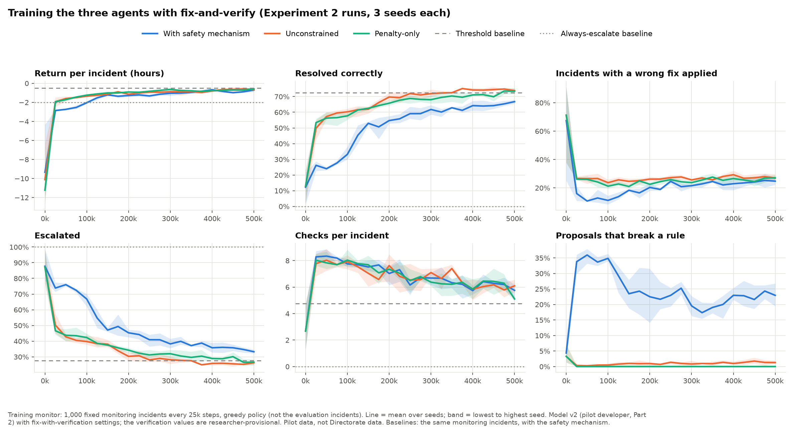
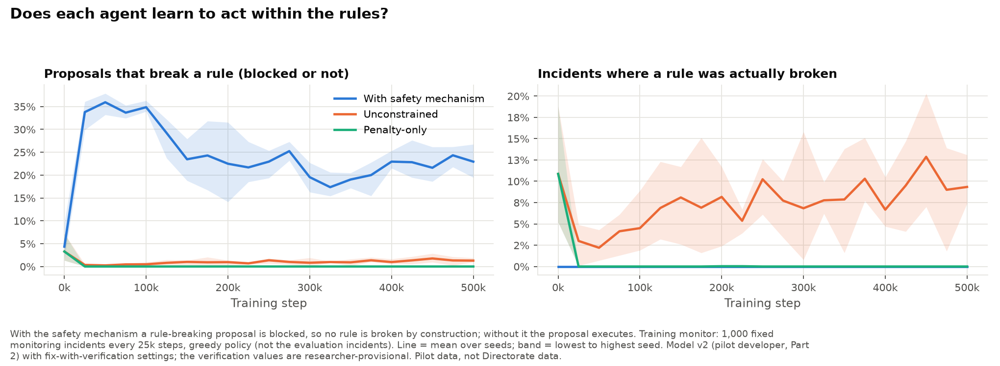
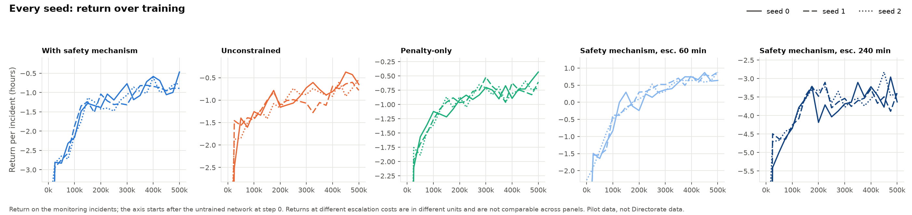
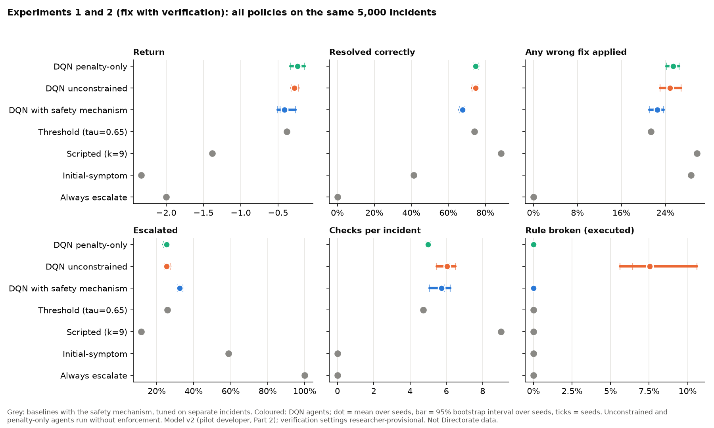
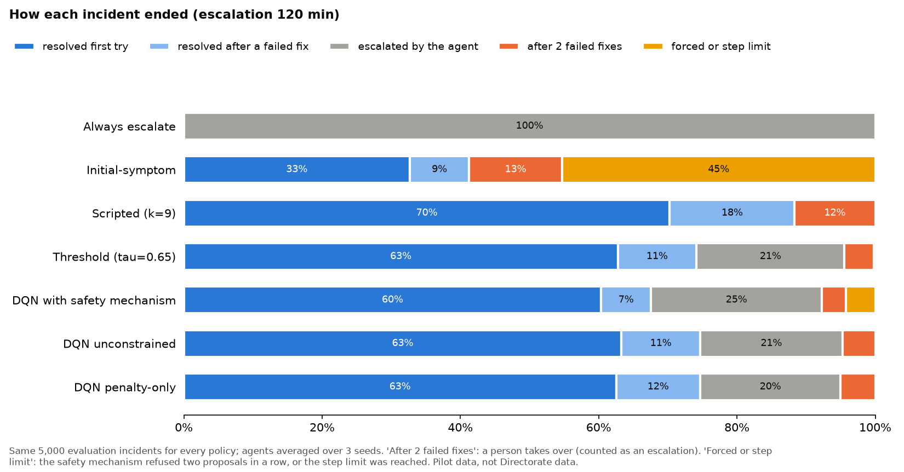
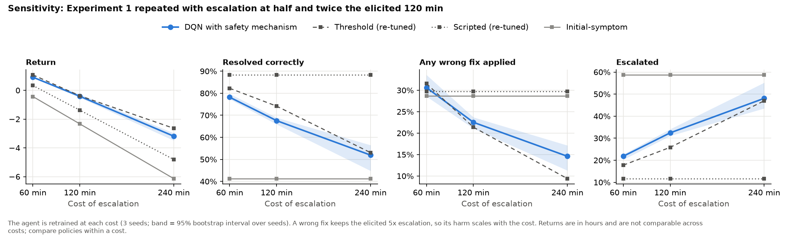
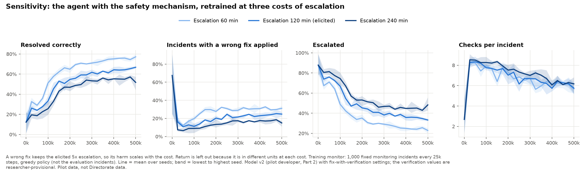

# Pilot Report: Investigate, Fix or Escalate

**Date:** 10 November 2026
**Status:** pilot. The scenario model comes from one developer of the Directorate (Part 1 and Part 2 workbooks), not from the planned Directorate elicitation, and several settings are the researcher's. The results show that the method runs, learns and can be evaluated as Chapter 3 plans. They are not thesis findings.
**Detail:** the step-by-step record is `documentation/pilot_experiment_plan.md` (Phases 0 to 9) and `documentation/phase9_log.md`. Tables: `results/pilot/comparison.md`, `results/pilot/phase5.md`, `results/pilot/prototype_v3.md`.

## 1. Summary

1. **The full pipeline works**: scenario model, simulated environment, safety mechanism, baselines, three learning agents, the evaluation of Chapter 3 Experiments 1 and 2, and a prototype that reads a ticket and its logs, decides, and carries the decision out on a fictional repository.
2. **Fix with verification is in place.** A fix is applied and verified. If it fails, the agent pays for the harm, sees that the fix failed and goes on, and after two failed fixes a person takes over. All results in Sections 4 and 5 use this setting.
3. **The agents match the strongest baseline, but do not beat it.** At the elicited escalation cost, the penalty-only (-0.24) and unconstrained (-0.28) agents edge past the threshold policy (-0.38), and the agent with the safety mechanism is level with it (-0.41). The intervals overlap. Every agent is far ahead of the scripted, initial-symptom and always-escalate baselines on return.
4. **The safety mechanism does its job, but at a cost the pilot exposes.** It brings executed violations to zero (unconstrained: 7.6% of incidents). However, the agent behind it keeps proposing rule-breaking fixes (22% of its proposals, still about 20% at the end of training), because in the pilot a blocked proposal costs only a step. The penalty-only agent learned to propose none and has the best compliant success.
5. **Against the Chapter 3 criteria, H1 and H2 are not supported in this pilot** (Section 6). This is useful: it shows where the design needs attention before the Directorate model, chiefly the cost of a blocked proposal and the strength of the scripted baseline once fixes are verified.

## 2. What was built

| Part | What it is | Where |
|---|---|---|
| Scenario model v2 | 8 causes, 11 checks (one delegated to a language model, D11), 4 symptoms, 5 rules, with per-cause owner and "fixed by a code change" flag. From the pilot developer's Part 1 and Part 2 workbooks | `experiments/pilot/pilot_model_v2.json` |
| Environment | Gymnasium environment of Chapter 3; noise, missing checks and overlap controls; optional fix with verification | `src/sim/` |
| Safety mechanism | Checks every proposal against the rules; a blocked proposal is returned once, a second block in a row escalates | `src/rules/safety.py` |
| Baselines | Always escalate, initial-symptom, scripted checklist, confidence threshold (given the likelihood model) | `src/agents/baselines.py` |
| Agents | Masked Double DQN: with the safety mechanism, unconstrained, penalty-only | `src/agents/dqn.py` |
| Experiments | Experiments 1 and 2 with the escalation-cost sensitivity analysis | `experiments/pilot/run_comparison.py`, `evaluate_comparison.py` |
| Prototype | Ticket and logs, then reader, agent, safety mechanism, verification, then a draft pull request, a fix order or a routed escalation | `src/prototype/`, `dashboard/prototype_app.py` |

**Fix with verification** (`pilot_settings_v3.json`). Applying the remedy for cause *j* takes its apply time. If *j* is the true cause, the symptoms clear and the incident is resolved. If not, the agent pays the apply time plus the remedy's harm, sees a "fix failed" flag for *j*, and *j* can no longer be chosen. After two failed fixes a person takes over at the escalation cost. The mean harm is set so that a wrong fix followed by escalation costs the elicited 5x escalation on average. It is spread across remedies by how hard each is to undo, following the reasons given for the rules: deleting rows weighs 2.0, rolling back a release or killing a transaction 1.5, and a code change by draft pull request 0.5.

## 3. Settings

| Setting | Value | Source |
|---|---|---|
| Escalation | 120 min (2 h) | Pilot developer |
| Wrong fix | 5x escalation | Pilot developer |
| Correct fix | +5 h | Researcher |
| Check cost, Low / Medium / High | 5 / 15 / 30 min | Researcher |
| Remedy apply times, harm weights, 2 failed fixes, step limit 15 | See `pilot_settings_v3.json` | Researcher (provisional; for a Part 3 workbook) |
| Noise, missing checks, overlap | 0.1, 0, 0 | Researcher |
| Training | Double DQN, 2 x 128 units, 500k steps, exploration to 5% by 150k, discount 1.0 | Tuned in Phase 4 |
| Penalty-only agent | 10 per rule-breaking action, training only | Researcher |
| Block cost | None beyond the step it uses (Chapter 3 specifies a small penalty) | Pilot deviation, see Section 7 |
| Seeds | 0, 1, 2 for each of 15 runs | Decision of 9 Nov 2026 |
| Evaluation | 5,000 incidents, the same for every policy, from seeds never used in training; baselines tuned on 2,000 separate incidents | Chapter 3 |

## 4. Training

Fifteen runs: the three agents at the elicited escalation cost (Experiment 2), and the agent with the safety mechanism retrained at 60 and 240 minutes (sensitivity analysis). With five runs in parallel, one thread each, a run takes about 70 minutes and all fifteen about 3.5 hours. All fifteen finished.



1. **All three agents learn.** Return rises from about -10 hours (untrained) to between -0.5 and -0.9 on the monitoring incidents, and every agent passes the always-escalate baseline within 25k steps.
2. **The agent with the safety mechanism learns more slowly.** It resolves fewer incidents than the other two for most of training (about 25% against 55% at 50k steps) and escalates more. The gap narrows but has not closed at 500k steps.
3. **All agents check more than the threshold policy** (5 to 6 checks against 4.7) and are still reducing their checks at the end of training. Longer training may help, as Phase 4 found.



4. **Rule-breaking proposals do not fall far.** With the safety mechanism, they rise to about 35% early in training and settle around 20 to 25%. The agent proposes a forbidden fix and lets the mechanism send it back for the required check. The penalty-only agent stops proposing them within 25k steps. The unconstrained agent proposes few (about 1%), but each one executes, and it breaks a rule in 7 to 13% of monitoring incidents.



5. **Seeds agree closely** at 120 and 60 minutes. At 240 minutes, seed 0 ends about 0.25 h below the other two.

## 5. Results: Experiments 1 and 2



| Policy | Return (h) [95% CI over seeds] | Resolved | Any wrong fix | Escalated | Checks | Rule-breaking proposals | Rule broken (executed) | Compliant success |
|---|---|---|---|---|---|---|---|---|
| Always escalate | -2.00 | 0% | 0% | 100% | 0.0 | 0% | 0% | 0% |
| Initial-symptom | -2.33 | 41.3% | 28.6% | 58.7% | 0.0 | 54.7% | 0% | 41.3% |
| Scripted (9 checks) | -1.38 | 88.3% | 29.7% | 11.7% | 9.0 | 0% | 0% | 88.3% |
| Threshold (0.65) | -0.38 | 74.1% | 21.4% | 25.9% | 4.7 | 4.7% | 0% | 74.1% |
| DQN with safety mechanism | -0.41 [-0.50, -0.27] | 67.6% | 22.5% | 32.4% | 5.7 | 22.4% | **0%** | 67.6% |
| DQN unconstrained | -0.28 [-0.32, -0.23] | 74.7% | 24.9% | 25.3% | 6.0 | 1.1% | **7.6%** | 67.9% |
| DQN penalty-only | -0.24 [-0.33, -0.14] | 74.7% | 25.4% | 25.3% | 5.0 | 0% | 0% | 74.7% |

**Paired comparison with the threshold policy** (difference in return on the same incidents, per seed, 95% bootstrap over incidents):

| Agent | Seed 0 | Seed 1 | Seed 2 |
|---|---|---|---|
| With safety mechanism | +0.11 [-0.02, +0.24] | -0.12 [-0.28, +0.02] | -0.09 [-0.24, +0.06] |
| Unconstrained | +0.09 [-0.05, +0.22] | +0.06 [-0.08, +0.19] | +0.15 [+0.02, +0.28] |
| Penalty-only | +0.14 [+0.01, +0.28] | +0.24 [+0.09, +0.39] | +0.05 [-0.09, +0.18] |



1. **The learned agents reach the threshold policy.** That policy is given the likelihood model the agents must learn, so Chapter 3 does not expect them to beat it. Two of three penalty-only seeds and one unconstrained seed do so with intervals above zero. The agent with the safety mechanism is level with it.
2. **The scripted checklist resolves the most incidents but has a poor return.** With verification, a checklist that always runs nine checks and then tries the most probable fix, and then the next one, resolves 88% of incidents. It pays for this with nine checks every time and a wrong fix in 30% of incidents. The comparison on resolution alone therefore favours it (see H1 in Section 6).
3. **The agents use verification sparingly.** They resolve 7 to 12% of incidents after a failed fix, against 18% for the scripted checklist. They escalate the rest themselves (20 to 25%) rather than run into the two-fix limit (3 to 5%).
4. **The safety mechanism adds forced escalations.** 4% of its incidents end because two proposals in a row were blocked or the step limit was reached. No other learned agent has any.
5. **Escalation quality is the same for every learned agent** (MCC 0.54 to 0.55, threshold 0.57). Escalating an incident is what the reference label expects about as often as it is for the threshold policy.

### Sensitivity to the cost of escalation

The agent with the safety mechanism was retrained with escalation at 60 and 240 minutes, and the threshold and scripted baselines were re-tuned at each cost. A wrong fix stays at 5x escalation, so its harm scales too, while the reward for a correct fix stays at 5 hours. "Escalation 240 min" therefore also makes every mistake relatively costlier.





| Escalation | Threshold re-tuned to | Agent return | Threshold return | Agent minus threshold, per seed |
|---|---|---|---|---|
| 60 min | 0.55 | 0.92 [0.87, 0.96] | 1.08 | -0.21, -0.16, -0.12 (all below zero) |
| 120 min | 0.65 | -0.41 [-0.50, -0.27] | -0.38 | +0.11, -0.12, -0.09 (level) |
| 240 min | 0.80 | -3.19 [-3.49, -2.98] | -2.64 | -0.85, -0.46, -0.34 (all below zero) |

6. **Behaviour moves in the expected direction.** As escalation and mistakes become costlier, the agent fixes less, escalates more (22%, 32%, 48%) and applies fewer wrong fixes (31%, 23%, 15%), as does the re-tuned threshold policy.
7. **The conclusion about the threshold policy depends on the cost.** The agent is level with the threshold policy only at the elicited 120 minutes, and below it at both other costs. At 240 minutes, 12% of its incidents end in forced escalations or the step limit, again because it proposes before it checks. Against the scripted, initial-symptom and always-escalate baselines its return is higher at every cost.

## 6. Hypotheses, against the Chapter 3 criteria

These are pilot readings with three seeds, not tests of the hypotheses.

| Hypothesis | Criterion (Chapter 3) | Pilot result | Reading |
|---|---|---|---|
| **H1**: higher resolution accuracy than the initial-symptom, scripted and always-escalate policies, with no more investigation cost than the scripted checklist | At least 0.05 higher, intervals not overlapping | 67.6% against 41.3% (initial-symptom), 0% (always escalate) and **88.3% (scripted)**; 5.7 checks against 9 | **Not supported**, because of the scripted checklist. On return the agent is far ahead (-0.41 against -1.38). Verification lets a fix-everything checklist resolve many incidents at a high cost, so resolution accuracy alone is a weak criterion in the fix-and-verify setting |
| **H2**: higher compliant success than the unconstrained and penalty-only agents | At least 0.05 higher, intervals not overlapping | 67.6% against 67.9% (unconstrained) and **74.7% (penalty-only)** | **Not supported.** The penalty-only agent learned the rules and broke none on these incidents |
| Zero executed violations with the mechanism | Must hold on every incident | 0 of 15,000 agent incidents | **Holds** (verification of the implementation) |
| Blocked proposals fall over training | Expected in Chapter 4 | 35% early, about 20 to 25% at the end | **Only partly.** A block costs only a step in the pilot |
| H3 (ambiguity) | Experiment 4 | Not run in this pilot | |

**What this means for the design.** The H2 result does not show that the safety mechanism is unnecessary. The penalty-only agent was evaluated only at the level it was trained on. In Phase 5 it broke rules in 4 to 7% of incidents once checks started to go missing, while the mechanism stayed at zero. Experiment 4 is where that difference shows. Two changes follow from the pilot:

- **Charge a block** (Chapter 3's λ<sub>block</sub>, which the pilot set to zero), so that the agent learns to check before proposing. Report it as a design ablation. This needs the supervisor's agreement.
- **Judge H1 on return as well as resolution accuracy,** or state the criterion against the scripted checklist with verification in mind, since a policy that tries fix after fix can resolve a lot at a high cost.

## 7. The prototype

The prototype puts the trained agent between a ticket and the action taken on it. It is shown in `dashboard/prototype_app.py`: triage a ticket, all example cases, the outbox and draft pull requests, and the reader's error rates. The agent is `v3_shielded_seed0`, chosen on its training-monitor return, not on the evaluation incidents.

**Verification in the prototype.** A fix for a code fault is applied to a staging copy of the fictional repository. It counts as working only if the incident's own reproduction test passes and no other test breaks. Any other fix is confirmed by the operator, or, for the example cases only, by the cause the case was written to show. A pull request is opened, as a draft, only after the fix is verified. Nothing is merged and nothing is sent; messages go to an outbox folder.

| Case | Written to show | Decision (v3 agent) | Earlier v2 agent (Phase 8) |
|---|---|---|---|
| results_approval | C02 | Fix C02, verified | Fix C02 |
| sign_in | C08 | Fix C08, verified (staging test), no checks | Fix C08 |
| transcript_duplicates | C07 | Fix C07, verified | Fix C07 |
| class_results_slow | C04 | Fix C04, verified (staging test) | Fix C04 |
| profile_cache | C05 | Fix C05, verified (staging test) | Escalate |
| fees_release | C06 | Escalate | Fix C07 (wrong) |
| payment_gateway | C01 | Escalate at the step limit, 6 blocked proposals | Escalate |
| vague_slow | none (escalate) | Tried C04, the fix failed, escalated | Fix C04 (wrong) |

Six of eight cases end as intended, against four with the v2 agent. `vague_slow` shows what verification adds: the agent's guess is caught by verification, not shipped. These eight cases were written by the researcher, as were the reader's keywords, so they show that the pipeline works, not how accurate it is. The pilot developer's 20 sample tickets measure accuracy. They are kept out of the repository because some may name real endpoints.

## 8. Limits

- **One developer, not the Directorate.** The model, the costs and the rules come from one person. The pilot's purpose is to test the method.
- **Researcher-set values.** The correct-fix reward, check costs, the verification settings (apply times, harm weights, two-fix limit) and the penalty of 10 are the researcher's. The verification settings in particular go to the developer in a Part 3 workbook.
- **Three seeds.** Chapter 3 plans ten. Several differences in Section 5 sit inside the seed intervals.
- **Block cost of zero.** This differs from Chapter 3 and probably explains most of the safety mechanism's cost here.
- **Base ambiguity level only.** Missing checks, more noise and overlap (Experiment 4) and the action ablations (Experiment 3) were not run.
- **Reliable verification.** A fix that clears the symptoms is assumed to have removed the true cause.
- **No exact reference.** The exact solver does not model verification, so the agents' distance from the best possible return is unknown in this setting (it was 0.65 h in Phase 5, without verification).

## 9. Next steps

1. Take the results and the questions in the pilot plan (Section 5) to the Directorate; ask for a Part 3 workbook on remedy times and harms.
2. Agree the block penalty with the supervisor; run it as an ablation of the agent with the safety mechanism.
3. Revisit the H1 criterion for the fix-and-verify setting.
4. Experiment 4 on the saved agents (missing checks and noise), where the penalty-only agent is expected to break rules and the mechanism is not.
5. Score the reader on the developer's 20 sample tickets (keyword and, with an API key, the Claude reader).

## Reproduce

```bat
python -m experiments.pilot.run_comparison train --parallel 5      :: 15 runs, about 3.5 h
python -m experiments.pilot.run_comparison evaluate                :: about 17 min; comparison.md and figures
python -m experiments.pilot.plot_v3_training                       :: training figures
python -m experiments.pilot.evaluate_prototype --out prototype_v3  :: the eight cases
streamlit run dashboard/prototype_app.py                           :: the prototype
```
